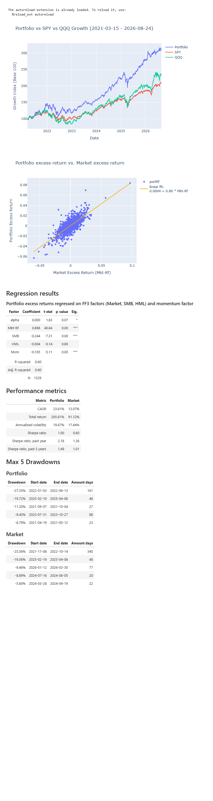

# financeproject
Stock returns analysis in Python. Downloads stock data from Alpaca API, constructs a multi-stock portfolio from historical transactions, runs Fama–French 3-factor regression and computes metrics like Sharpe ratios.

## Prerequisites
Prepare the data
- [Download Fama–French 3 factors (CSV ZIP)](https://mba.tuck.dartmouth.edu/pages/faculty/ken.french/ftp/F-F_Research_Data_Factors_CSV.zip) and put the csv to data\F-F_Research_Data_Factors_daily.csv.
- [Download momentum factor (CSV ZIP)](https://mba.tuck.dartmouth.edu/pages/faculty/ken.french/ftp/F-F_Momentum_Factor_daily_TXT.zip) and put the csv to data\F-F_Momentum_Factor_daily.csv.
- Add Alpaca API keys (for stock returns) to config\alpaca_config.json (see sample json in config).
- Replace the sample in portfolio_transactions.csv with tickers and stock transactions of your choosing.

Setup python venv and dependencies
- python3 -m venv .venv
- source .venv/bin/activate
- pip install -e .

## Running the pipeline
Analysis pipeline and report:
- run: python ./src/pipeline/run.py
- see: output\analysis.html

Tests:
python -m pytest tests\

## Sample portfolio report
